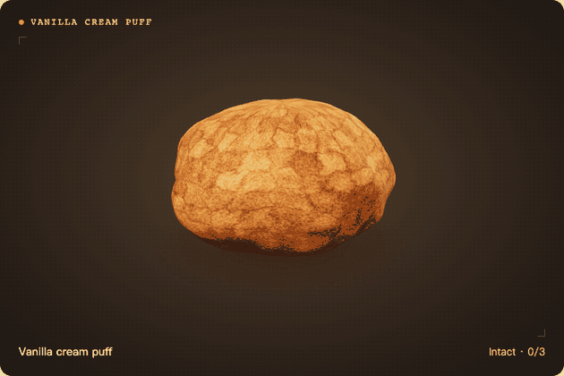

# Crunch Lab | Squishy Simulator

[繁體中文](README.md) · **English**

Crack open a piece of Dubai chocolate or squeeze a vanilla cream puff until custard pushes through the cracks. Your camera tracks how far your fingers curl. The tighter you make a fist, the flatter the 3D food gets. In two-item mode, you can pick a different food for each hand and squeeze them independently.

**[Play Crunch Lab](https://ericthegoatskr.github.io/crunch-lab/)**



## How to play

1. Choose **One** or **Two**, then pick what to squeeze. In two-item mode, choose a squishy for each side.
2. Select **Start camera** and allow access. Bring your hand into view, open your palm, then make a fist. Open your hand between squeezes so the next one registers. In two-item mode, you can squeeze with either hand or both at once.
3. Sound is on by default. Select the speaker icon to mute it. You can also use the on-screen buttons or the space bar without starting the camera.

The interface follows your browser’s language preferences. Use the menu in the top right to switch between Traditional Chinese, Simplified Chinese, and English. Your browser remembers your choice.

## What you can squeeze

| Texture | Squishies | What happens when you squeeze |
| --- | --- | --- |
| Crisp | Dubai chocolate, butter stick, macaron, vanilla cream puff | The first squeeze makes fine cracks, the second exposes the filling, and the third scatters the shell fragments. Cracks stay when you release. Each item shows its progress in the lower-right corner. |
| Bouncy | Fried egg, doughnut | Each item flattens as you squeeze and springs back when you release. You can squeeze it again and again. |

The vanilla cream puff starts to ooze custard on the second squeeze. Squeeze harder without opening your hand to push more custard through the cracks while staying at stage two.

## Camera and privacy

The 3D scene requires a browser with WebGL 2 support. Camera mode requires HTTPS or localhost. When you first start the camera, the browser downloads the MediaPipe hand-tracking model from Google. Camera footage and hand landmarks are processed in your browser.

## Local development

Use Node.js 22.12 or later.

```sh
git clone https://github.com/Ericthegoatskr/crunch-lab.git
cd crunch-lab
npm ci
npm run dev
```

Open the local address shown in your terminal. Run `npm test` to run the tests or `npm run build` to build the site into `dist/`. Pushes to `main` trigger GitHub Actions to test, build, and publish the site to GitHub Pages.

Three.js renders the 3D scene, MediaPipe tracks your hands, and the Web Audio API synthesizes the crack and rebound sounds. The project was inspired by [Namusu’s Blender demo](https://www.youtube.com/watch?v=Tb3xt4yurXY).
