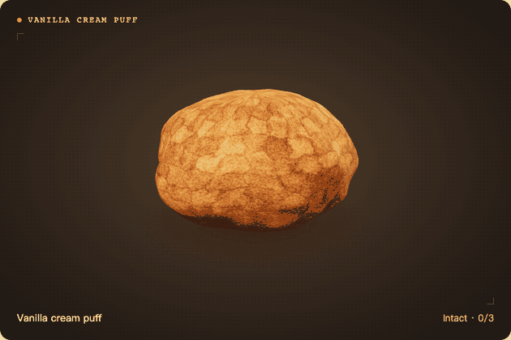

# Crunch Lab｜脆皮捏捏模擬器

**繁體中文** · [English](README.en.md)

在瀏覽器裡捏碎一顆杜拜巧克力，或把香草菠蘿泡芙捏到卡士達從裂縫擠出來。相機會追蹤手指彎曲的程度，握得越緊，3D 食物就壓得越扁。雙顆模式可以各選一款，用兩隻手分別控制。

**[立即試玩 Crunch Lab](https://ericthegoatskr.github.io/crunch-lab/)**



## 怎麼玩

1. 選「捏一顆」或「捏兩顆」，再挑款式。雙顆模式可分別設定左右兩顆。
2. 點「開啟相機」並允許存取。把手放進畫面，先張開手掌，再握拳。每捏一次後先鬆手，才會計入下一次。雙顆模式下，兩隻手可以各自握拳，也可以同時捏。
3. 音效預設開啟，點喇叭圖示可以靜音。也可以直接用畫面上的按鈕或空白鍵試玩，無需開啟相機。

介面會依瀏覽器的語言偏好顯示。右上角可手動選擇繁體中文、簡體中文或 English，瀏覽器會記住選擇。

## 可以捏什麼

| 手感 | 款式 | 握拳與鬆手時的反應 |
| --- | --- | --- |
| 脆皮 | 杜拜巧克力、奶油塊、馬卡龍、香草菠蘿泡芙 | 第一次出現細裂，第二次露出內餡，第三次才散落碎片。鬆手會保留裂痕，進度顯示在各自畫面的右下角。 |
| 回彈 | 荷包蛋、甜甜圈 | 握緊時壓扁，鬆手時回彈，可以一直捏。 |

香草菠蘿泡芙從第二次握拳開始會擠出卡士達。你可以在同一次握拳中繼續加力，看到更多內餡從裂縫冒出，進度仍停在第二階段。

## 相機與隱私

3D 畫面需要支援 WebGL 2 的瀏覽器。相機模式需要 HTTPS 或 localhost，第一次開啟相機時會從 Google 下載 MediaPipe 手部模型。相機影像和手部關鍵點都在瀏覽器內處理。

## 本機開發

需要 Node.js 22.12 或以上版本。

```sh
git clone https://github.com/Ericthegoatskr/crunch-lab.git
cd crunch-lab
npm ci
npm run dev
```

開啟終端機顯示的本機網址。使用 `npm test` 執行測試，或使用 `npm run build` 建置到 `dist/`。推送到 `main` 後，GitHub Actions 會執行測試、建置並發布到 GitHub Pages。

Three.js 負責 3D 渲染，MediaPipe 負責手部追蹤，Web Audio API 合成脆裂與回彈聲。專案靈感來自 [Namusu 的 Blender 示範](https://www.youtube.com/watch?v=Tb3xt4yurXY)。
